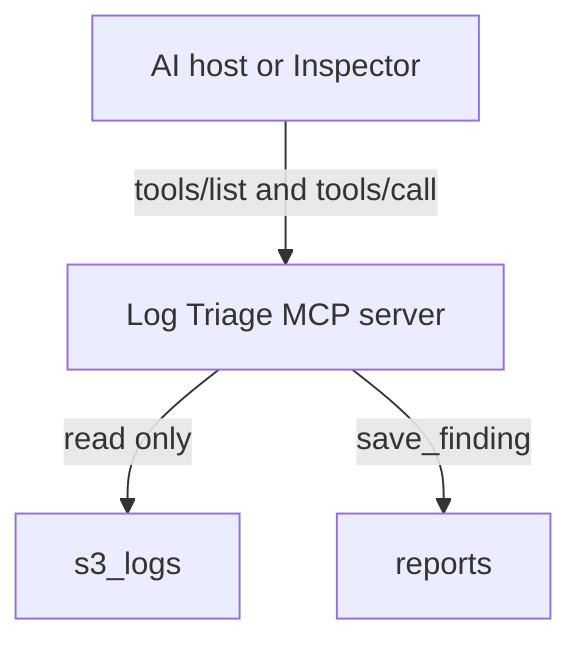

# Practice 1: Build the surface and the contract (Go)
**Practice files**:

> [Contract](CONTRACT.md): Exact server behavior and tool contracts
> [Interface worksheet](interface.md): Your design before you compare it with the supplied contract
> [Checklist](CHECKLIST.md): Manual completion checks
> [Coding-agent instructions](CLAUDE.md): Scope and constraints for AI-assisted work

Build the first working stage of Log Triage, an MCP server that helps an AI investigate a directory of mixed infrastructure logs. You will design its public interface, implement four tools, and verify the behavior through the MCP protocol.

The contract defines observable behavior. It does not prescribe your package names or internal file layout. Choose an implementation structure that keeps protocol code, log reading, and report writing understandable without copying the completed solution.

## Links
- [MCP Go SDK](https://github.com/modelcontextprotocol/go-sdk)
- [MCP specification used by this practice](https://modelcontextprotocol.io/specification/2025-11-25)
- [MCP Inspector](https://github.com/modelcontextprotocol/inspector)

**Project references**:

- [Log format rules](../docs/log-formats.md)
- [Log bundle guide](../docs/s3-logs.md)

## What you will build
Your server will:

- identify itself as `log-triage` version `0.1.0`;
- communicate over standard input and standard output;
- read plain-text and gzip-compressed logs under a configured root;
- expose four MCP tools with complete input and output schemas;
- return bounded structured results with an equivalent JSON text block;
- reject paths outside the configured log root;
- remove the write tool when started in read-only mode.

The checks start your program as a separate process and talk to it through MCP. They do not import your Go packages, so your internal design remains your choice.

## How the pieces fit


The server receives tool calls from an AI host. Read tools inspect the supplied log corpus. The write tool stores an investigation report in a separate reports directory. Protocol messages use standard output, so diagnostics belong on standard error.

## Design reminders
Begin with the questions the AI must answer. Each distinct decision should have one clear operation.

| Contract part | What it tells the AI or client |
|---------------|--------------------------------|
| Name | Which operation is available |
| Description | When to call it and what it returns |
| Input schema | Which arguments are accepted, including defaults and limits |
| Output schema | Which result fields the client can rely on |
| Annotations | Whether the operation reads data, writes data, or may replace existing data |
| Tool result | The structured answer, its text copy, or an actionable error |

The model reads names, descriptions, and annotations when choosing a tool. The SDK and client enforce the schemas. Both layers are part of the public contract.

In Go, named input and output structs make that contract easier to inspect. JSON tags control field names, while schema tags describe fields and constraints. The exact values and defaults are listed in [CONTRACT.md](CONTRACT.md).

## MCP surface in this stage
MCP offers three server primitives:

- Tools are operations an AI model can choose and call.
- Resources are addressable context that an application can read.
- Prompts are reusable workflows that a user selects.

This stage publishes tools only. It intentionally has no MCP resources and no MCP prompts. Coding-agent prompts in the practice lesson help you implement the project, but they are not MCP prompts exposed by your server.

### `list_logs`
Use this discovery tool when the AI needs to learn which files exist below a path and which format each file uses. It returns file metadata without including log contents. Pagination keeps large directories manageable.

Example input:

```json
{
  "path": "vms/web-01",
  "limit": 20,
  "offset": 0
}
```

The result identifies each file's relative path, size, compression state, and detected format. It also reports the total and shown counts so the caller knows whether more entries remain.

### `summarize_logs`
Use this analysis tool for questions such as "What went wrong in this folder during this time window?" It parses known log formats, counts severity levels, and groups repeated messages into a bounded answer.

Example input:

```json
{
  "path": "vms/web-01",
  "since": "2026-08-31T03:00:00Z",
  "until": "2026-08-31T03:30:00Z",
  "min_level": "warning",
  "limit": 20
}
```

The result includes the observed time range, counts by level, and the most relevant message groups. Unknown file formats may be listed by `list_logs`, but this tool skips them because it cannot parse their records safely.

### `search_logs`
Use this evidence tool when the AI has a concrete regular expression and needs matching raw lines with file names and line numbers. Pagination lets the caller continue a search without requesting every match at once.

Example input:

```json
{
  "path": "vms/web-01",
  "pattern": "(?i)upstream|timeout",
  "limit": 20,
  "offset": 0
}
```

The result preserves the raw matching line and adds its source location. Time and severity filters are available when the search should cover only part of the corpus.

### `save_finding`
Use this write tool after the investigation has enough evidence to record a conclusion. It creates a Markdown report from a title, severity, summary, and source references.

Example input:

```json
{
  "title": "Investigation title",
  "severity": "medium",
  "summary": "Short conclusion supported by the evidence below.",
  "evidence": [
    {
      "file": "path/from-a-tool-result.log",
      "line": 123,
      "note": "What this line proves."
    }
  ]
}
```

Saving the same slug again replaces the existing report. The tool must therefore advertise that it writes data and can be destructive. It is absent when the server runs with `--read-only`.

## Contract expectations
Use [CONTRACT.md](CONTRACT.md) as the source of truth for exact fields, defaults, bounds, annotations, server instructions, and error text.

While implementing it, check these properties:

- Tool descriptions explain both the purpose and the result within the required length.
- Inputs reject invalid enum values, limits, timestamps, and regular expressions.
- Defaults work when optional arguments are omitted.
- Output schemas match the structured content returned at runtime.
- Every successful tool result contains `structuredContent` and one text block with the same JSON value.
- Bounded lists report `total`, `shown`, and a note when the result is incomplete.
- Expected failures return tool errors that help the AI correct its next call.
- Unregistered tool names remain protocol-level errors.

An ordinary Go error returned by a tool handler becomes a tool result marked with `isError`. Keep protocol errors separate from domain failures such as an invalid path or regular expression.

## Log-reading domain
The corpus contains nine supported formats: application logs, Nginx access logs, Nginx error logs, PHP-FPM logs, PostgreSQL logs, Redis logs, syslog, pytest output, and Go test output.

Your reader must also account for:

- plain and `.gz` files;
- recursive byte-order path traversal;
- hidden names that must be skipped;
- content-based format detection;
- multi-line message grouping;
- UTF-8 replacement for invalid bytes;
- one-based line numbers;
- half-open time windows where `since <= time < until`.

Do not infer these rules from the sample data alone. Implement the definitions in [docs/log-formats.md](../docs/log-formats.md).

## Repository map
Only the student-facing parts are shown here. Your implementation stays under `solution/`, but its internal folders are up to you.

```text
build-your-own-mcp-go-sdk/
├── 1-surface-and-contract/  # Contract, worksheet, checks, and Inspector config
├── docs/                    # Log formats and corpus notes
├── reports/                 # Findings written by save_finding
├── s3_logs/                 # Read-only input corpus
└── solution/                # Your Go implementation
```

Keep `s3_logs/` read-only. The server may write only inside the configured reports directory.

## Set up the project
You need Go 1.26 or newer, Node.js 22.19 or newer, Git, and a coding agent or editor.

From the repository root, install the check dependencies and confirm that the starter state fails because no server exists yet:

```bash
# Run from the repository root.
go -C 1-surface-and-contract/checks mod download
go -C 1-surface-and-contract/checks test -count=1 ./...
```

That initial failure is expected. Once your server starts correctly, the same command becomes the main verification command.

## Suggested build order
1. Complete [interface.md](interface.md) before reading the supplied contract closely. Record the questions the server should answer and the operations you would expose.
2. Compare your design with [CONTRACT.md](CONTRACT.md). Preserve your original worksheet and explain meaningful differences. Leave the original design unchanged.
3. Create the stdio server and register the four declared tools with their schemas and annotations.
4. Implement the shared log reader from the format specification.
5. Add the three read tools, then the report-writing tool.
6. Run the matching check file after each increment.
7. Inspect the published surface before using the server to solve the investigation case from the practice lesson.

The coding-agent prompts and the investigation question remain in the practice lesson. This README describes the project contract and how to verify it.

## Verify each capability
Run the full suite from the repository root:

```bash
# Run from the repository root.
go -C 1-surface-and-contract/checks test -count=1 ./...
```

You can also run one check file at a time from the repository root:

| Check file | Capability |
|------------|------------|
| `t2_server_test.go` | Server identity, startup, instructions, and tool registration |
| `t3_reading_test.go` | Log formats, gzip handling, grouping, paths, and time windows |
| `t4_list_logs_test.go` | Discovery, pagination, metadata, and bounds |
| `t5_summarize_logs_test.go` | Counts, severity filters, groups, and bounded results |
| `t6_search_logs_test.go` | Regex matches, source locations, filters, and errors |
| `t7_save_finding_test.go` | Report writing, replacement behavior, and read-only mode |

For example:

```bash
# Run from the repository root.
go -C 1-surface-and-contract/checks test -count=1 t2_server_test.go harness_test.go
```

## Inspect the MCP surface
The Inspector config starts your server with the fixture root and a temporary reports directory. From `1-surface-and-contract`, list the normal tool surface:

```bash
# Run from 1-surface-and-contract/.
npx @modelcontextprotocol/inspector --cli \
  --config inspector.json \
  --server log-triage \
  --method tools/list \
  --format json
```

Check read-only mode separately:

```bash
# Run from 1-surface-and-contract/.
npx @modelcontextprotocol/inspector --cli \
  --config inspector.json \
  --server log-triage-read-only \
  --method tools/list \
  --format json
```

The first response should contain four tools. The read-only response should contain three and omit `save_finding`.

Call a read tool through the protocol:

```bash
# Run from 1-surface-and-contract/.
npx @modelcontextprotocol/inspector --cli \
  --config inspector.json \
  --server log-triage \
  --method tools/call \
  --tool-name summarize_logs \
  --tool-args-json '{"path":"vms/cache-01/syslog.log","min_level":"any"}'
```

Known Go SDK issue: when the Inspector closes a stdio session, Go SDK v1.7.0 can return `server is closing: EOF`, after which `go run` prints `exit status 1`. These shutdown lines do not change the JSON response that precedes them. See [go-sdk issue #855](https://github.com/modelcontextprotocol/go-sdk/issues/855).

## Completion check
Before submitting your work:

- compare `tools/list` with the contract;
- call every tool at least once through MCP;
- confirm `save_finding` is missing in read-only mode;
- run the full Go check suite;
- review [CHECKLIST.md](CHECKLIST.md);
- keep generated reports and local build artifacts out of your commit.
