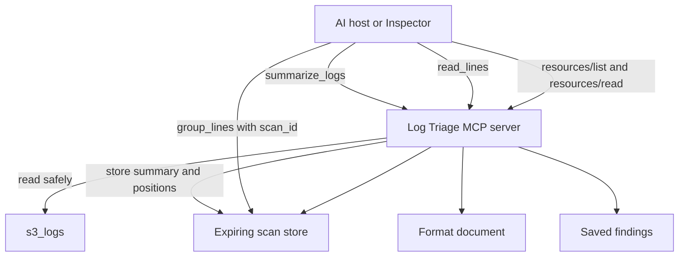

# Practice 2: State, safety, and errors (Go)
**Practice files**:

> [Contract](CONTRACT.md): Exact stage-two behavior, schemas, resources, and error text
> [State worksheet](interface.md): Decide which results deserve a handle
> [Hostile inputs](hostile-inputs.md): Paths and files the server must handle safely
> [Checklist](CHECKLIST.md): Manual completion checks
> [Coding-agent instructions](CLAUDE.md): Scope and constraints for AI-assisted work

Extend the Log Triage server from the first stage. Expensive summaries now produce short-lived scan handles, callers can retrieve focused evidence without repeating a scan, and hosts can read server documents as MCP resources. You will also add path confinement, predictable refusals, and masked unexpected failures.

The contract defines behavior visible through MCP. It does not prescribe your packages or internal file layout. Keep your implementation in `solution/` and preserve the interface choices you recorded before reading the supplied contract.

## Links
- [MCP Go SDK v1.7.0](https://pkg.go.dev/github.com/modelcontextprotocol/go-sdk@v1.7.0/mcp)
- [MCP tools specification](https://modelcontextprotocol.io/specification/2026-07-28/server/tools)
- [MCP resources specification](https://modelcontextprotocol.io/specification/2026-07-28/server/resources)
- [MCP Inspector CLI](https://modelcontextprotocol.io/docs/2026-07-28/tools/inspector/cli)

**Project references**:

- [Earlier surface contract](../1-surface-and-contract/CONTRACT.md)
- [Log format rules](../docs/log-formats.md)
- [Log bundle guide](../docs/s3-logs.md)

## What you will build
Your stage-two server will:

- identify itself as `log-triage` version `0.2.0`;
- add expiring, caller-owned scan handles to `summarize_logs`;
- expose `group_lines` and `read_lines`;
- publish two resources and two resource templates;
- keep at most 20 scans per caller and remain safe under concurrent calls;
- screen direct paths, walked entries, and stored paths before file access;
- cap file and line processing as the contract specifies;
- distinguish schema refusals, expected tool errors, and masked unexpected failures;
- make `save_finding` create-only and remove it in read-only mode.

The earlier four tools remain part of the surface. This stage changes the behavior of `summarize_logs` and `save_finding`, so the earlier checks must continue to pass.

## How state and resources fit


A handle is useful when a later call needs an expensive result or part of it. It is an opaque reference and does not prove identity. The server still checks the caller, expiry, and retained data whenever the handle is used.

## MCP surface in this stage
This stage has six tools, two resources, and two resource templates. It publishes no MCP prompts.

### Tools
| Tool | Main goal | Example input |
|------|-----------|---------------|
| `list_logs` | Discover files and detected formats before choosing a target | `{"path":"vms/web-01","limit":20}` |
| `summarize_logs` | Scan a file or folder, group repeated messages, and create a reusable scan | `{"path":"vms/web-01","min_level":"warning"}` |
| `search_logs` | Find raw lines that match a known regular expression | `{"path":"vms/web-01","pattern":"(?i)timeout","limit":20}` |
| `group_lines` | Page one message group's lines from an existing scan | `{"scan_id":"<scan-id>","group_id":"<group-id>","limit":50}` |
| `read_lines` | Read a bounded window around one known line | `{"path":"vms/web-01/nginx-error.log","line":42,"before":5,"after":10}` |
| `save_finding` | Save a new evidence-backed Markdown report | `{"title":"Investigation title","severity":"medium","summary":"...","evidence":[...]}` |

Use `summarize_logs` for the broad pass, then reuse its `scan_id` with `group_lines`. Use `read_lines` when a search result or group line needs nearby context. `search_logs` remains the better choice when you already know the expression to find.

Example summary input:

```json
{
  "path": "vms/cache-01/syslog.log",
  "since": "2026-09-07",
  "until": "2026-09-08",
  "min_level": "any",
  "limit": 20
}
```

The result contains a random `scan_id`, an `expires_at` value, and the normal summary fields. A later `group_lines` call uses the returned identifiers:

```json
{
  "scan_id": "s_0123456789abcdef",
  "group_id": "0123456789ab",
  "limit": 50,
  "offset": 0
}
```

The identifiers above illustrate the wire shape. Use values returned by your running server.

### Resources
Resources let a host fetch addressable context without asking the model to choose a tool.

| URI | Kind | Main goal | Example use |
|-----|------|-----------|-------------|
| `triage://formats` | Resource | Describe the nine supported log formats | Read before interpreting format-specific levels or timestamps |
| `triage://reports` | Resource | List saved findings | Show which reports already exist before saving another |
| `triage://reports/{name}` | Template | Read one saved finding | Read `triage://reports/example-finding` |
| `triage://scans/{scan_id}` | Template | Read the stored summary for one scan | Reopen the summary represented by a valid scan id |

Resource lists and reads carry the contract's private freshness metadata. An unknown report, expired scan, or another caller's scan returns a resource-not-found protocol error.

Example CLI read from `2-state-safety-errors/`:

```bash
# Run from 2-state-safety-errors/.
npx @modelcontextprotocol/inspector --cli \
  --config inspector.json \
  --server log-triage \
  --method resources/read \
  --uri triage://formats \
  --format json
```

### Prompts
This stage publishes no MCP prompts. The coding-agent prompts remain in the practice lesson and are not part of the server's MCP surface.

## Design reminders
State needs explicit ownership and limits. For every handle, decide:

- what work the server retains;
- which caller may use it;
- when it expires;
- how many handles one caller may keep;
- what the caller sees after it disappears.

Safety checks belong at every path boundary. Validate a path supplied by a caller, each entry found during traversal, and a stored path reopened later. Rechecking stored paths prevents a file or parent directory replaced with a symlink from escaping the root.

Schema validation covers shape, types, bounds, and closed objects. Runtime checks still own facts that schemas cannot know, such as whether a file exists, a line is present, a scan has expired, or a report name collides.

## Error model
Keep three failure classes separate:

| Failure | Example | MCP result |
|---------|---------|------------|
| Schema refusal | Unknown argument or invalid enum | SDK refusal before the handler runs |
| Expected domain failure | Missing file, expired scan, report collision | Tool result with `isError: true` and the contract text |
| Unexpected failure | Broken decoder or panic outside a named contract case | Masked tool error for the caller, detail only on stderr |

Use [CONTRACT.md](CONTRACT.md) for the exact E1 to E10 messages and their order. A refused `save_finding` must write nothing.

## Repository map
Only the folders students need are shown. Your package layout inside `solution/` remains your choice.

```text
build-your-own-mcp-go-sdk/
├── 1-surface-and-contract/  # Earlier contract and regression checks
├── 2-state-safety-errors/   # Current contract, worksheet, checks, and Inspector config
├── docs/                    # Log formats and corpus notes
├── reports/                 # Findings written by save_finding
├── s3_logs/                 # Read-only input corpus
└── solution/                # Your existing Go server, extended in place
```

Keep the earlier worksheet unchanged. Complete [interface.md](interface.md), compare it with the contract, and record meaningful differences without replacing your original design.

## Set up the project
You need Go 1.26 or newer, Node.js 22.19 or newer, Git, and a coding agent or editor.

From the repository root:

```bash
# Run from the repository root.
go -C 1-surface-and-contract/checks test -count=1 ./...
go -C 2-state-safety-errors/checks mod download
go -C 2-state-safety-errors/checks test -count=1 ./...
```

The earlier suite should pass before you begin. The stage-two suite initially fails because the server does not yet publish the new state, tools, resources, and safety behavior.

## Suggested build order
1. Complete the state worksheet before studying the supplied state design.
2. Add the scan store, lifetime flag, caller ownership, and new summary fields.
3. Add `group_lines`, then `read_lines`.
4. Publish the resources and resource templates.
5. Apply path screening and file limits to direct reads, walks, and stored rereads.
6. Finish runtime validation, create-only findings, and unexpected-error masking.
7. Run the earlier suite after every increment.
8. Inspect the published tools and resources, then exercise [hostile-inputs.md](hostile-inputs.md).

The practice lesson contains the coding-agent prompts and investigation case. This README describes the project and its observable contract.

## Verify each capability
Run both suites from the repository root:

```bash
# Run from the repository root.
go -C 2-state-safety-errors/checks test -count=1 ./...
go -C 1-surface-and-contract/checks test -count=1 ./...
```

| Check file | Capability |
|------------|------------|
| `t2_scans_test.go` | Version, configured lifetime, scan ids, expiry, ownership, and concurrency |
| `t3_group_lines_test.go` | Stored groups, paging, caps, expiry, and eviction |
| `t4_read_lines_test.go` | Bounded context windows and file-specific refusals |
| `t5_resources_test.go` | Resource discovery, documents, templates, not-found behavior, and freshness |
| `t6_paths_test.go` | Path confinement, symlink replacement, file limits, and skipped files |
| `t7_checks_test.go` | Time, regex, evidence, collision, annotations, and masked failures |

`-count=1` prevents Go from reporting a cached pass after `solution/` changes.

## Inspect the published surface
From `2-state-safety-errors`, list resources and templates:

```bash
# Run from 2-state-safety-errors/.
npx @modelcontextprotocol/inspector --cli --config inspector.json --server log-triage --method resources/list --format json
npx @modelcontextprotocol/inspector --cli --config inspector.json --server log-triage --method resources/templates/list --format json
npx @modelcontextprotocol/inspector --cli --config inspector.json --server log-triage --method resources/read --uri triage://formats --format json
```

List the normal and read-only tool surfaces:

```bash
# Run from 2-state-safety-errors/.
npx @modelcontextprotocol/inspector --cli --config inspector.json --server log-triage --method tools/list --format json
npx @modelcontextprotocol/inspector --cli --config inspector.json --server log-triage-read-only --method tools/list --format json
```

The normal server lists six tools. Read-only mode lists five and omits `save_finding`.

Each CLI invocation starts a new server, so a `scan_id` from one invocation will not work in the next. Use the Inspector web UI for a stateful sequence:

```bash
# Run from 2-state-safety-errors/.
npx @modelcontextprotocol/inspector --config inspector.json
```

Connect to `log-triage-expiry`, call `summarize_logs`, pass its identifiers to `group_lines`, then repeat after five seconds to observe expiry.

Known Go SDK issue: when the Inspector closes a stdio session, Go SDK v1.7.0 can return `server is closing: EOF`, after which `go run` prints `exit status 1`. These shutdown lines do not change the JSON response that precedes them. See [go-sdk issue #855](https://github.com/modelcontextprotocol/go-sdk/issues/855).

## Completion check
Before submitting your work:

- run both check suites;
- inspect tools, resources, and templates;
- verify scan expiry in one Inspector connection;
- try every case in [hostile-inputs.md](hostile-inputs.md);
- confirm read-only mode omits only `save_finding`;
- review [CHECKLIST.md](CHECKLIST.md);
- keep local build artifacts out of your commit.
