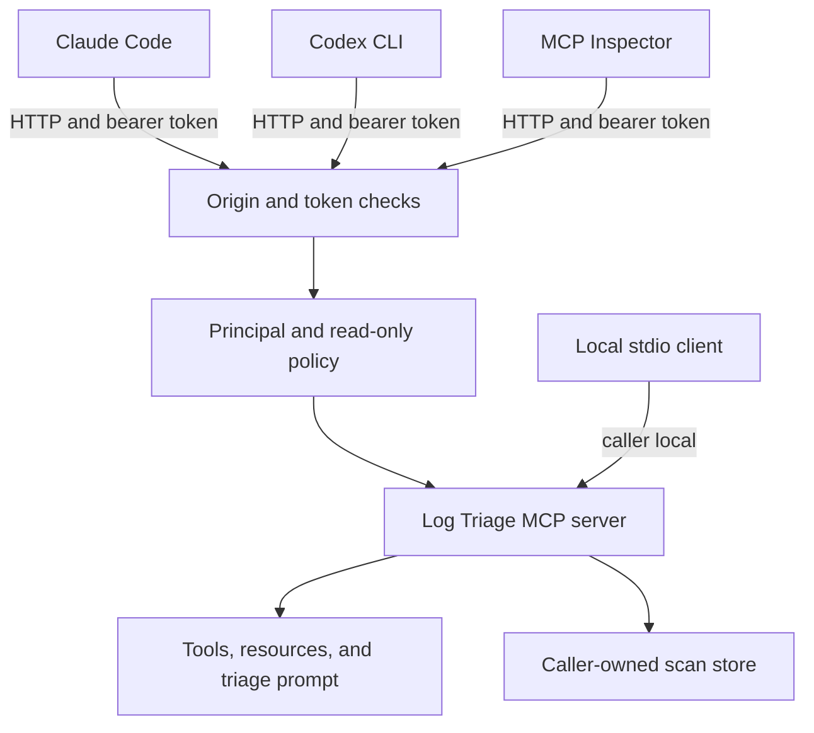

# Practice 4: Integrate with agents and clients (Go)
**Practice files**:

> [Contract](CONTRACT.md): Exact stage-four surface, prompt, caller, and HTTP behavior
> [Host guide](hosts.md): Connect Claude Code and Codex CLI over HTTP
> [Investigation cases](cases.md): Questions to answer through an agent host
> [Example tokens](tokens.example.env): Local-only bearer-token configuration
> [Checklist](CHECKLIST.md): Manual completion checks and host observations
> [Coding-agent instructions](CLAUDE.md): Scope and constraints for AI-assisted work

Put the Log Triage server behind real agent hosts. You will add stateless Streamable HTTP, authenticate requests with local example bearer tokens, isolate scan state by caller, publish a guided `triage` prompt, and compare how two hosts present the same MCP server.

This is the final stage of the same project in `solution/`. Stdio remains the default, so every earlier practice must still pass. HTTP adds another way to reach the server without changing the tools' domain behavior.

## Links
- [MCP Go SDK Streamable HTTP handler](https://pkg.go.dev/github.com/modelcontextprotocol/go-sdk@v1.7.0/mcp#StreamableHTTPHandler)
- [MCP Go SDK protocol and transports](https://github.com/modelcontextprotocol/go-sdk/blob/v1.7.0/docs/protocol.md)
- [MCP prompts specification](https://modelcontextprotocol.io/specification/2026-07-28/server/prompts)
- [MCP Streamable HTTP specification](https://modelcontextprotocol.io/specification/2026-07-28/basic/transports/streamable-http)
- [MCP Inspector CLI](https://modelcontextprotocol.io/docs/2026-07-28/tools/inspector/cli)

**Project references**:

- [Earlier testing contract](../3-testing-and-debugging/CONTRACT.md)
- [Log format rules](../docs/log-formats.md)
- [Log bundle guide](../docs/s3-logs.md)

## What you will build
Your final server will:

- identify itself as `log-triage` version `0.4.0`;
- keep stdio as the default transport;
- serve stateless Streamable HTTP at `/mcp` with `--http HOST:PORT`;
- load token-to-principal mappings from `LOG_TRIAGE_TOKENS`;
- reject foreign origins before checking the bearer token;
- keep each scan under the principal that created it;
- publish a smaller tool list to read-only principals;
- expose a reusable `triage` MCP prompt;
- work from Claude Code, Codex CLI, and the MCP Inspector.

The example token file is for local practice only. Do not use its values for a real service, and do not commit personal tokens or host registration files.

## How hosts reach the server


The HTTP transport is stateless at the protocol layer. Every request carries the information needed to identify the operation and caller. A `scan_id` is ordinary application state: it connects later calls to stored work but does not authenticate its user.

## MCP surface in this stage
The final surface contains seven tools, two resources, two resource templates, and one prompt.

### Tools
| Tool | Main goal | Example input |
|------|-----------|---------------|
| `list_logs` | Discover files and formats | `{"path":"pods","limit":20}` |
| `summarize_logs` | Produce counts, groups, and a caller-owned scan | `{"path":"pods","since":"2026-09-09T09:00","until":"2026-09-09T13:00"}` |
| `search_logs` | Find raw evidence with a regular expression | `{"path":"pods","pattern":"(?i)invoice|timeout","limit":20}` |
| `group_lines` | Page one group from a scan | `{"scan_id":"<scan-id>","group_id":"<group-id>","limit":50}` |
| `read_lines` | Read context around one source line | `{"path":"path/from-a-result.log","line":123,"before":5,"after":10}` |
| `timeline` | Measure frequency and numeric movement across time buckets | `{"scan_id":"<scan-id>","pattern":"latency","bucket_minutes":60}` |
| `save_finding` | Save a new evidence-backed report | `{"title":"Investigation title","severity":"high","summary":"...","evidence":[...]}` |

An analyst principal sees all seven tools. A read-only principal sees six because `save_finding` is absent. If that principal still sends a valid `save_finding` call, the server returns E13. The global `--read-only` flag removes the tool for every caller.

Every `tools/list` result has private cache scope because the visible list depends on the caller.

### Resources
| URI | Main goal | Example use |
|-----|-----------|-------------|
| `triage://formats` | Describe supported log formats | Read before comparing format-specific timestamps |
| `triage://reports` | List saved findings | Check which reports already exist |
| `triage://reports/{name}` | Read one finding | Read `triage://reports/example-finding` |
| `triage://scans/{scan_id}` | Read one caller-owned summary | Reopen a valid scan summary |

Another principal's scan is reported as not found. Resource lists and reads remain private.

### The `triage` prompt
The prompt frames an investigation for an agent that has no prior knowledge of the corpus.

| Argument | Required | Purpose |
|----------|----------|---------|
| `symptom` | yes | What the user observed |
| `path` | no | A file or folder to inspect |
| `since` | no | Start of the investigation window |
| `until` | no | End of the investigation window |

The rendered prompt repeats supplied arguments, names the tool order, asks for a quiet-window comparison, and requires source lines for claims. It describes a method without embedding answers from the training corpus.

Example Inspector call:

```bash
# Run from 4-agents-and-clients/.
npx @modelcontextprotocol/inspector --cli \
  --config inspector.json \
  --server log-triage-http \
  --method prompts/get \
  --prompt-name triage \
  --prompt-args "symptom=pages time out" path=pods \
  --format json
```

Agent hosts expose prompts through their own command syntax. Follow [hosts.md](hosts.md) for the exact Claude Code and Codex steps.

## Design reminders
An MCP server and an agent host have different responsibilities:

| Component | Responsibility |
|-----------|----------------|
| Server | Publish operations, data, prompt templates, annotations, and errors |
| Transport | Carry MCP requests and responses |
| Authentication layer | Map a request token to a principal and policy |
| Host | Present the server to a user, ask for tool permission, and run the model |
| Model | Choose tools and interpret their results |

A tool annotation helps a host choose an approval policy, but the server must still enforce write restrictions. Host permission is a user-interface decision; bearer-token policy and `--read-only` are server-side controls.

Stateless HTTP does not mean the application has no state. It means one request does not rely on an HTTP session. Scan ownership comes from the bearer token's principal and is checked again on later requests.

## HTTP safety
The local practice server applies checks in this order:

1. Refuse a non-local `Origin` with HTTP 403.
2. Refuse a missing or unknown bearer token with HTTP 401 and a `WWW-Authenticate: Bearer` header.
3. Attach the token's principal and read-only policy to the request.
4. Dispatch the MCP operation.

With `--http`, stdout stays empty. Startup messages, access diagnostics, and tool-call logs belong on stderr.

The example environment file maps two analyst tokens to the same principal and one token to a read-only viewer. Two tokens for one principal can use the same scan; a different principal cannot.

## Repository map
Only the folders students need are shown. The completed implementation's internal folder structure is intentionally omitted.

```text
build-your-own-mcp-go-sdk/
├── 1-surface-and-contract/  # Earlier regression checks
├── 2-state-safety-errors/   # Earlier regression checks
├── 3-testing-and-debugging/ # Earlier regression checks and student test fixtures
├── 4-agents-and-clients/    # Current contract, host guide, cases, checks, and config
├── docs/                    # Log formats and corpus notes
├── reports/                 # Findings saved through an agent host
├── s3_logs/                 # Read-only input corpus
└── solution/                # Your existing Go server, extended in place
```

`.mcp.json` and personal Codex configuration are machine-specific host registrations. Keep them out of the project commit.

## Set up the project
You need Go 1.27.1 or newer, Node.js 22.19 or newer, Git, Claude Code, and Codex CLI or another second MCP host.

From the repository root:

```bash
# Run from the repository root.
go -C 1-surface-and-contract/checks test -count=1 ./...
go -C 2-state-safety-errors/checks test -count=1 ./...
go -C 3-testing-and-debugging/checks test -count=1 ./...
go -C 4-agents-and-clients/checks mod download
go -C 4-agents-and-clients/checks test -count=1 ./...
```

The first three suites should pass. The final suite initially fails because the server does not yet provide HTTP, caller policy, or the `triage` prompt.

## Suggested build order
1. Add `--http` and stateless Streamable HTTP while preserving stdio.
2. Load token mappings and apply Origin and bearer checks.
3. Carry the principal through the request context and scope scans to it.
4. Make `tools/list` and `save_finding` respect read-only principals.
5. Add and test the `triage` prompt.
6. Run the full cumulative test chain.
7. Register the running HTTP server in two hosts using [hosts.md](hosts.md).
8. Solve the required cases from [cases.md](cases.md) and record what each host showed.

The practice lesson contains the coding-agent prompts. This README describes the finished project behavior and how to exercise it.

## Build and start HTTP locally
Load the local example tokens:

```bash
# Run from the repository root.
set -a
. 4-agents-and-clients/tokens.example.env
set +a
```

Build and start the server from the repository root:

```bash
# Run from the repository root.
go -C solution build -o bin/log-triage ./cmd/log-triage
solution/bin/log-triage \
  --root s3_logs \
  --reports reports \
  --http 127.0.0.1:8765
```

The server waits for HTTP requests at `http://127.0.0.1:8765/mcp`. Keep that terminal open while using the Inspector or a host.

If you also verify the inherited stdio mode, note a [known Go SDK issue](https://github.com/modelcontextprotocol/go-sdk/issues/855): Go SDK v1.7.0 can return `server is closing: EOF` when the Inspector closes the session, after which `go run` prints `exit status 1`. These shutdown lines do not change the preceding JSON response and do not affect the HTTP checks below.

## Verify each capability
Run all project suites:

```bash
# Run from the repository root.
go -C solution test -count=1 ./...
go -C 4-agents-and-clients/checks test -count=1 ./...
go -C 3-testing-and-debugging/checks test -count=1 ./...
go -C 2-state-safety-errors/checks test -count=1 ./...
go -C 1-surface-and-contract/checks test -count=1 ./...
```

| Check file | Capability |
|------------|------------|
| `t1_http_test.go` | HTTP startup, authentication, Origin checks, protocol compatibility, stdout, and logging |
| `t2_principals_test.go` | Caller-owned scans, read-only surfaces, private lists, per-caller caps, and findings |
| `t3_prompt_test.go` | Prompt arguments, descriptions, rendered guidance, ordering, and refusals |

`-count=1` prevents a cached pass after `solution/` changes.

## Inspect authentication and the prompt
With the HTTP server running, execute these commands from `4-agents-and-clients`:

```bash
# Run from 4-agents-and-clients/.
npx @modelcontextprotocol/inspector --cli --config inspector.json --server log-triage-http --method tools/list --format json
npx @modelcontextprotocol/inspector --cli --config inspector.json --server log-triage-http-viewer --method tools/list --format json
npx @modelcontextprotocol/inspector --cli --config inspector.json --server log-triage-http-no-token --stored-auth-only --method tools/list --format json
```

The analyst entry lists seven tools. The viewer lists six without `save_finding`. The no-token entry reports that authorization is required.

Render the prompt:

```bash
# Run from 4-agents-and-clients/.
npx @modelcontextprotocol/inspector --cli --config inspector.json --server log-triage-http --method prompts/get --prompt-name triage --prompt-args "symptom=pages time out" path=pods --format json
```

The Inspector passes the multi-word symptom as one argument. Host command parsers may behave differently, which is why [hosts.md](hosts.md) documents each one.

## Use real hosts
Follow [hosts.md](hosts.md) to:

- register the HTTP endpoint in Claude Code without storing the token value;
- register it in Codex CLI through an environment-variable name;
- compare the analyst and viewer surfaces;
- confirm each host asks before `save_finding`;
- remove the temporary registrations when the practice is complete.

Then use the `triage` prompt and the questions in [cases.md](cases.md). Read every proposed write before allowing it, and verify cited lines against the source files.

## Completion check
Before submitting your work:

- run your own suite and all four practice suites;
- confirm the analyst, viewer, and no-token Inspector outcomes;
- render `triage` with all argument shapes you support;
- connect both hosts and observe write approval;
- save findings for the two required cases;
- record host behavior in [CHECKLIST.md](CHECKLIST.md);
- confirm no token or machine-specific registration enters the commit.
