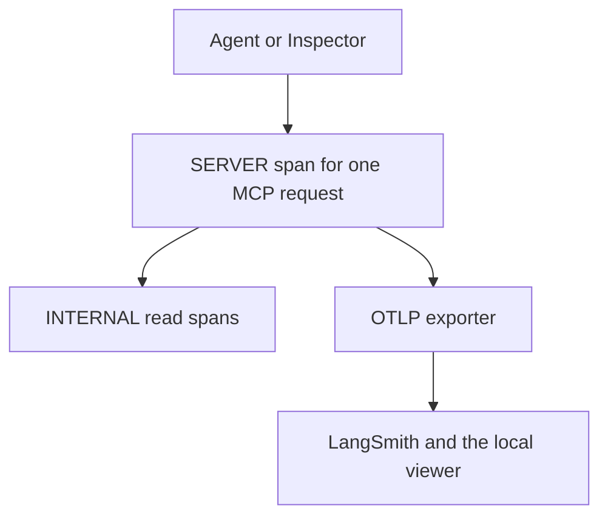

# Practice 5: Integrate telemetry for MCP (Go)

**Practice files**:

> [CONTRACT](CONTRACT.md): Export, span and privacy rules
> [starter](starter/telemetry.go): The exporter setup and bounded flush that task 1 wires in
> [hosts](hosts.md): Register a host, choose a backend and clean up
> [CHECKLIST](CHECKLIST.md): Record verified behavior and trace observations
> [AGENTS](AGENTS.md): Boundaries for your coding assistant
> [CLAUDE](CLAUDE.md): The same rules for Claude Code

Log Triage already investigates logs over stdio and authenticated HTTP. This stage adds traces that show which requests arrived and where each request spent time. You finish with the same MCP surface and an opt-in OTLP exporter.

The contract defines observable behavior, not package names or the final file layout. Your implementation stays in `solution/`.

## Links

- [go-sdk v1.7.0](https://github.com/modelcontextprotocol/go-sdk/tree/v1.7.0)
- [OpenTelemetry Go](https://opentelemetry.io/docs/languages/go/instrumentation/)
- [MCP trace conventions](https://github.com/open-telemetry/semantic-conventions-genai/blob/main/docs/gen-ai/mcp.md)
- [LangSmith OTLP](https://docs.langchain.com/langsmith/trace-with-opentelemetry)
- [Inspector CLI](https://modelcontextprotocol.io/docs/2026-07-28/tools/inspector/cli)

**Project references**:

- [HTTP-stage contract](../4-agents-and-clients/CONTRACT.md)
- [Log formats](../docs/log-formats.md)
- [Host connection guide](../4-agents-and-clients/hosts.md)

## What you will build

- `log-triage` version `0.5.0`, retaining the existing tools, resources and prompt.
- Optional OTLP/HTTP export with bounded shutdown and service metadata, from the provided starter module.
- Request spans that carry caller context, plus per-file read spans.
- Safe telemetry attributes and trace IDs in debug call logs.

The checks launch your program as a separate process and exchange MCP messages with it. Your internal design remains yours.

## How tracing fits



The request remains the parent of each measured operation. The exporter sends ended sampled spans independently of the MCP response.

## MCP surface in this stage

Telemetry adds no MCP interface. These capabilities keep their existing contracts.

| Tool | Main goal | Example input |
|---|---|---|
| `list_logs` | Discover available files | `{"path":".","limit":5}` |
| `summarize_logs` | Scan once for counts and message groups | `{"path":".","min_level":"any"}` |
| `search_logs` | Find matching evidence | `{"path":".","pattern":"timeout"}` |
| `group_lines` | Reuse a scan to inspect one group | `{"scan_id":"<returned-id>","group_id":"<returned-group>","limit":10}` |
| `read_lines` | Read context around an evidence line | `{"path":"<listed-file>","line":10}` |
| `timeline` | Measure a pattern over a stored scan | `{"scan_id":"<returned-id>","pattern":"timeout","bucket_minutes":60}` |
| `save_finding` | Record a conclusion with evidence | Supply `title`, `severity`, `summary`, and file/line/note evidence as below |

Replace angle-bracket placeholders with values returned by your server. A finding input has this shape:

```json
{
  "title": "Example observation",
  "severity": "low",
  "summary": "Describe the observation supported by the cited line.",
  "evidence": [{"file": "<listed-file>", "line": 1, "note": "Explain what this line supports."}]
}
```

| Resource | Kind | Goal and example use |
|---|---|---|
| `triage://formats` | Static | Read supported formats |
| `triage://reports` | Static | List saved findings |
| `triage://scans/{scan_id}` | Template | Read a retained summary |
| `triage://reports/{name}` | Template | Read a saved finding |

### Prompts

The `triage` MCP prompt guides an investigation. Coding-agent prompts in the lesson build the server and are separate from this published prompt.

## Design reminders

A span measures one operation. Shared trace and parent IDs relate it to the caller's work. A scan handle identifies retained analysis data and does not identify a trace.

A read span measures the work behind a call, not the size of its answer. `CONTRACT.md`, Read spans, defines what each counter counts.

Safe telemetry describes operations without copying tool arguments or results. The backend still receives caller identities and timing information, so treat access to it as operational access.

A tool refusal remains a valid MCP response with `isError: true`. Its span records the failure through its status and `error.type`, not through an exception made up for the purpose.

## Repository map

Only student-facing folders are shown.

```text
solution/                    Your cumulative server and tests
5-telemetry/                  Contract, starter module and completion record
5-telemetry/checks/           Black-box checks and local OTLP viewer
4-agents-and-clients/         HTTP contract and host configuration reference
s3_logs/                     Read-only investigation corpus
reports/                     Findings saved through MCP
docs/                        Log-format reference
```

Keep the corpus, contracts and checks unchanged. Write server code in `solution/`.

## Set up the project

Use Go 1.27.1 or newer, go-sdk v1.7.0, and Node.js 22.19 or newer for the Inspector. The existing solution module already uses Go 1.27.1. OpenTelemetry dependencies are pinned by the contract. The lesson sends traces to LangSmith, which shows the span tree and durations, and reads the counters and error types in the supplied local viewer, which needs no account. On Windows, every command runs in PowerShell 7 (`pwsh`, 7.3 or newer). On Linux, keeping the LangSmith key in your desktop keyring needs `libsecret-tools` ([hosts.md](hosts.md)).

```bash
# Run from the repository root.
go -C solution test -count=1 ./...
go -C 5-telemetry/checks test -count=1 ./...
```

With the HTTP-stage server, the new checks fail with missing-span messages. The template's empty `solution/` must first be replaced by your cumulative implementation or the completed HTTP-stage project.

## Suggested build order

1. The provided exporter setup from `starter/telemetry.go`, wired into startup and every way out.
2. Request spans, log correlation and caller context across both transports.
3. Per-file read evidence.
4. Verified privacy and an unchanged MCP response contract.

Use the lesson for coding-agent prompts and the investigation case.

## Verify each capability

```bash
# Run from the repository root.
go -C solution test -count=1 ./...
go -C 5-telemetry/checks test -count=1 ./...
```

| Check file | Capability |
|---|---|
| `t1_export_test.go` | Disabled export, service metadata, EOF and signal flush |
| `t2_spans_test.go` | Request names, kinds, errors and log correlation |
| `t2_context_test.go` | Metadata parents, sampling, independent calls and requests without params |
| `t3_reads_test.go` | Read work, line records counted in the bytes read, reduced stored-scan reads |
| `t4_privacy_test.go` | Payload exclusion, refused resource URIs and authenticated caller identity |

```bash
# Run from the repository root: one task's checks.
go -C 5-telemetry/checks test -count=1 -run '^TestT2'
```

## Watch a call in the local viewer

Start the receiver in one terminal:

```bash
# Run from the repository root, terminal A.
go -C 5-telemetry/checks run ./cmd/tracetail
```

Start the server in another terminal:

```bash
# Run from the repository root, terminal B.
# macOS and Linux
go -C solution build -o bin/log-triage ./cmd/log-triage
set -a
. 4-agents-and-clients/tokens.example.env
set +a
export OTEL_EXPORTER_OTLP_ENDPOINT=http://127.0.0.1:4318
export OTEL_SERVICE_NAME=log-triage
unset OTEL_EXPORTER_OTLP_TRACES_ENDPOINT OTEL_EXPORTER_OTLP_HEADERS OTEL_EXPORTER_OTLP_TRACES_HEADERS
solution/bin/log-triage --root s3_logs --reports reports --http 127.0.0.1:8765 --log-level debug

# Windows (PowerShell)
go -C solution build -o bin/log-triage.exe ./cmd/log-triage
Get-Content 4-agents-and-clients/tokens.example.env | ForEach-Object { if ($_ -match '^(\w+)=(.*)$') { Set-Item -Path "Env:$($Matches[1])" -Value $Matches[2] } }
$env:OTEL_EXPORTER_OTLP_ENDPOINT = 'http://127.0.0.1:4318'
$env:OTEL_SERVICE_NAME = 'log-triage'
Remove-Item Env:OTEL_EXPORTER_OTLP_TRACES_ENDPOINT, Env:OTEL_EXPORTER_OTLP_HEADERS, Env:OTEL_EXPORTER_OTLP_TRACES_HEADERS -ErrorAction Ignore
./solution/bin/log-triage.exe --root s3_logs --reports reports --http 127.0.0.1:8765 --log-level debug
```

Make one call from a third terminal:

```bash
# Run from 5-telemetry/, terminal C.
npx @modelcontextprotocol/inspector --cli --config inspector.json --server log-triage-http --method tools/call --tool-name list_logs --tool-arg path=. --tool-arg limit=2 --format json
```

The call produces `tools/call list_logs` with read children in the receiver. Wait for the batch, or stop the server normally to flush it. The viewer prints updated snapshots, so the same span ID can appear in more than one snapshot. Count each span ID once.

Use another loopback port with `tracetail -port` if 4318 is occupied, and update the exporter endpoint. Stop the server before stopping the receiver. The receiver is a local development aid, not an authenticated production collector.

## Completion check

- Existing MCP results remain unchanged.
- Local traces identify calls and their read work.
- Context propagation and privacy checks pass.
- Your evidence and manual observations are recorded in [CHECKLIST.md](CHECKLIST.md).
